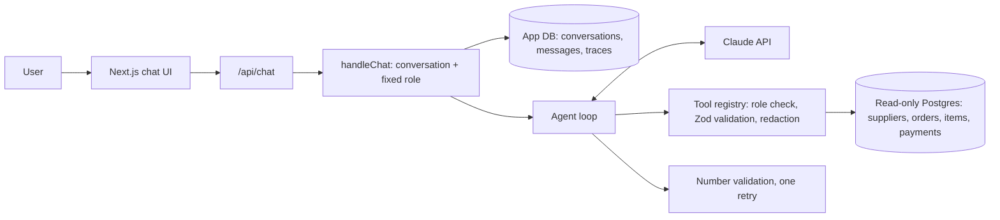

# Purchase Order AI Assistant

Ask plain-English questions about purchase orders. Claude answers by calling read-only database tools, never by writing SQL. **All data is fake.**

<!-- GIF placeholder: record a short demo (role switch, an ambiguous supplier, "How I got this") and save it as docs/demo.gif -->

> 🎬 **Demo GIF coming soon.** Save it as `docs/demo.gif` and replace this line with ``.

> **Latest eval: 20/20 passed** · `claude-opus-5-5`, effort `medium` · 2026-11-21 ([details](#evals))

## Why this exists

A chatbot that answers "how many orders are pending?" is easy. It isn't production-ready until it also handles:

- **Permissions.** A warehouse user must not see payment data, even if they ask cleverly.
- **Ambiguity.** "ABC" matches three suppliers. The assistant should ask which one, not guess.
- **Tool selection.** The right lookup has to be picked every time, and that has to be measured, not assumed.
- **Validation.** Every number in an answer should be traceable to the database.
- **Memory.** "…and how many of those are overdue?" has to work.

This repo is a small, complete example of those five things.

## Features

- Chat UI with a role switcher (Warehouse, Accounts, Admin) and suggested questions
- A **"How I got this"** panel under each answer: every tool called, its inputs, and a result summary
- A **Verified / Unverified numbers** badge on answers that contain numbers
- Clarifying questions with clickable options (e.g. the three ABC suppliers)
- `/logs` page with recent traces: question, tools, latency, tokens, validation result
- An eval suite of 20 questions, with expected answers computed by SQL

## Architecture



One question flows like this:

1. The API loads the conversation. Its role was fixed when the conversation was created.
2. The last 20 messages of history are loaded, trimmed by whole turns.
3. Claude receives the system prompt, **only the tools that role may use**, the history, and the question.
4. While Claude asks for tools, the loop runs them (in parallel within a round, up to 5 rounds) on a **read-only** connection and sends the results back.
5. The numbers in the final answer are checked against the tool results. On a mismatch Claude retries once; if it fails again, the answer is shown with a warning.
6. The turn is saved to memory and a trace row is recorded.

| Path                     | What's there                                                     |
| ------------------------ | ---------------------------------------------------------------- |
| [src/tools/](src/tools/) | The 8 tools, the registry, redaction, and the SQL helper         |
| [src/agent/](src/agent/) | Loop, system prompt, memory, validation, roles, traces           |
| [src/db/](src/db/)       | Drizzle schema, seed generator, migrations, read-only role setup |
| [src/app/](src/app/)     | Next.js pages and the `/api/chat` route                          |
| [evals/](evals/)         | Questions and runner                                             |
| [tests/](tests/)         | Unit and DB tests (no API key needed)                            |

### Tools

| Tool                         | Purpose                                                                                      |
| ---------------------------- | -------------------------------------------------------------------------------------------- |
| `search_suppliers`           | Fuzzy name → `supplier_id`. Returns `ambiguous: true` with candidates when it can't pick one |
| `count_purchase_orders`      | Counts with a breakdown by status; can rank suppliers                                        |
| `list_purchase_orders`       | Matching orders, `total_count`, at most 50 rows                                              |
| `get_purchase_order_details` | One PO: items, received quantities, timeliness, payments                                     |
| `get_supplier_summary`       | Totals, value, counts by status, on-time rate                                                |
| `get_payment_dues`           | Outstanding and overdue payments (Accounts/Admin only)                                       |
| `get_delivery_summary`       | Delivered, late, pending and overdue for a period; can rank suppliers                        |
| `ask_clarification`          | Ends the turn with a question and clickable options                                          |

## Design decisions

**Why tool calling instead of RAG.** The questions are about exact counts, sums and statuses in structured data. Retrieving text chunks and letting the model add things up invites wrong numbers. With tools, the database does the arithmetic and the model only picks the query and phrases the answer.

**Why the model never writes SQL.** Generated SQL is hard to make safe: injection, runaway queries, and access to columns a role shouldn't see. Each tool here is a fixed, parameterized query with a validated input schema (Zod) and a row limit. The model chooses tools and filters, not query text. Every tool runs on an `agent_readonly` Postgres role that can only `SELECT` from four tables, runs every transaction read-only, and has a 3-second statement timeout.

**Why permissions are enforced twice.**

1. Claude is only _sent_ the tools a role may use, so a warehouse user's assistant doesn't know `get_payment_dues` exists.
2. Every tool re-checks the role when it runs and strips any `amount`, `price` or `payment` field from its output. It also refuses payment filters and sorting by amount, which would leak data indirectly.

The first layer keeps the model honest. The second still holds if the first is bypassed (prompt injection, a bug in the tool list). The role is stored on the conversation and read from the DB, never from the request, so the client can't escalate mid-chat.

**Why suppliers are resolved by id.** Names are fuzzy ("ABC", "Ganesh Stel"). If every tool accepted a name, each would need its own matching logic, and silent bad matches would be likely. Instead, `search_suppliers` is the only place names are interpreted. It applies one explicit rule:

- an exact name wins;
- otherwise, candidates must score at least 0.3 (`pg_trgm` similarity or word similarity);
- the top candidate must lead the next by 0.15.

If no candidate clears that rule, the result is ambiguous and the assistant must ask. Every other tool takes `supplier_id`.

**How validation works.** Every number in the answer is extracted, ignoring PO numbers, dates, years, quarters, list markers and names like `M12`. It must match a number Claude was actually given: tool outputs (including amounts like `"10930.60"`), row counts, tool inputs, the user's question, or earlier turns' tool results. Matching allows rounding to the precision written, so `87.3` may appear as "87%". On a mismatch Claude gets one retry naming the bad numbers. That retry message is never saved to memory.

**Validation limits.**

- It catches invented and self-computed numbers, but not a correct number with the wrong label.
- It's fooled by coincidences. In one eval answer Claude wrote "the other 4", computed as 6 − 2, and it passed because a 4 happened to appear elsewhere in the tool results.
- Numbers written as words ("three") aren't checked.

Treat validation as a strong guardrail, not proof.

**Other choices.**

- **Money:** stored and summed as integer cents. It's converted to a decimal string only at the edges, using integer math.
- **Fixed demo date:** `DEMO_TODAY` pins "today", so seed data, "this quarter" and eval expectations are reproducible. The system prompt includes precomputed date ranges, so the model doesn't do calendar arithmetic.
- **Memory:** trimmed by whole turns, so a `tool_use` is never separated from its `tool_result`. Thinking blocks from earlier turns are dropped on replay, because current models bind a thinking block to the exact history before it.
- **Caching:** the system prompt and tool list are byte-identical within a role, so they stay in the prompt cache.

## Setup

Requirements: Node 20+, Docker (with the `docker compose` plugin), and an Anthropic API key.

```bash
git clone https://github.com/priyank8141/purchase-order-ai-assistant.git
cd purchase-order-ai-assistant
npm install
cp .env.example .env          # then set ANTHROPIC_API_KEY

npm run db:up                 # Postgres 16 on localhost:5433
npm run db:migrate            # schema + pg_trgm + read-only role
npm run db:seed               # fake data: 20 suppliers, 300 orders
npm run dev                   # http://localhost:3000
```

Other commands:

| Command                           | What it does                                                   |
| --------------------------------- | -------------------------------------------------------------- |
| `npm test`                        | 99 unit and DB tests, using a fake Claude client (no API cost) |
| `npm run chat -- warehouse`       | Chat in the terminal as a role                                 |
| `npm run eval -- --dry-run`       | Shows eval expected values from SQL (no API cost)              |
| `npm run eval`                    | Runs the eval suite against Claude                             |
| `npm run db:reset`                | Drops everything, then re-migrates and re-seeds                |
| `npm run lint` / `npm run format` | ESLint / Prettier                                              |

Environment variables are documented in [.env.example](.env.example). The model is always read from `ANTHROPIC_MODEL`.

## Evals

[evals/questions.json](evals/questions.json) holds 20 questions. Each has a role, expected tools, and an expected value defined as a **SQL query that runs at eval time**, so expectations stay correct if the seed changes.

| Type         | Count | Passes when                                                                 |
| ------------ | ----- | --------------------------------------------------------------------------- |
| count / list | 8     | the expected tools were called and the SQL value appears in the answer      |
| ambiguity    | 3     | the assistant asks, offering every matching supplier                        |
| permission   | 3     | no amounts leak, and a small judge model confirms it's a role-based refusal |
| follow-up    | 3     | the second turn's answer contains the expected value                        |
| unclear      | 3     | the assistant asks a clarifying question                                    |

```bash
npm run eval                                       # all questions
npm run eval -- --only unclear-late,po-status      # a subset
npm run eval -- --model claude-sonnet-5-5 --effort low
```

Results print as a table and are saved to `evals/results/<timestamp>.json`.

**Latest run:** 20/20 on `claude-opus-5-5` (effort `medium`), 2026-11-21. It used 184k input tokens (most served from cache) and 4.8k output tokens, and each question took 2–10 seconds.

## Limitations and what I'd add next

- **Write actions with human approval.** For example "approve PO-2026-0101": the model proposes the change and a person confirms it in the UI before anything is written.
- **Better fuzzy matching.** Supplier aliases and abbreviations ("PRE" → Pacific Rim Electronics), and learning from past clarifications.
- **Caching tool results** for repeated questions, and streaming answers to the UI.
- **Stronger validation.** Check that numbers are attached to the right label, not just present.
- **Real authentication.** The role switcher is a demo device; production would derive roles from the signed-in user.
- **A larger eval set** with paraphrases and adversarial prompts (e.g. trying to talk past permissions), run in CI.

## Note on data

Every supplier, order, amount and person in this project is generated by [`src/db/generateSeed.ts`](src/db/generateSeed.ts) with a fixed seed. None of it is real.
